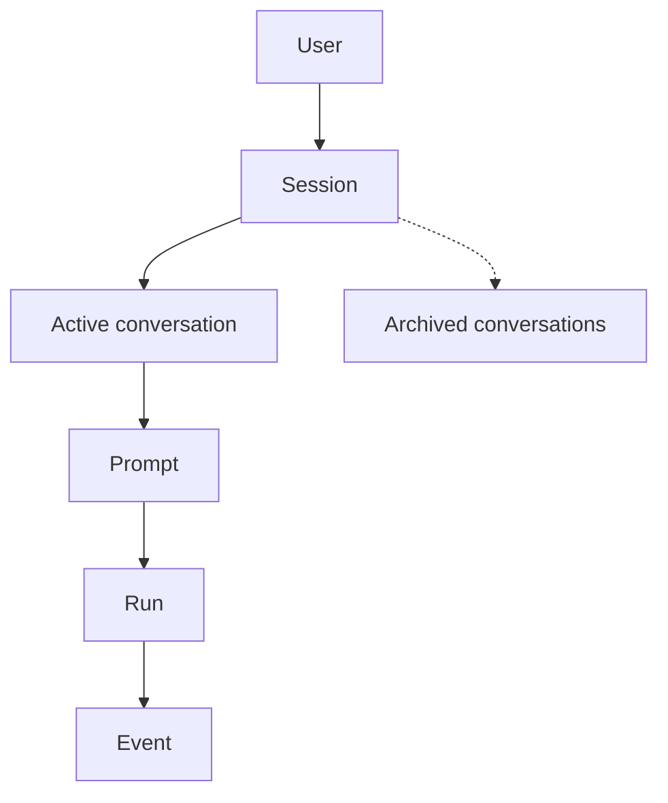

# Glossary

The words the product uses for its parts. The maintainer defined the settled terms on
2026-11-12 and 2026-11-13. [mvp.md](mvp.md) uses them; where an older issue or a harness
type uses the same word for something else, the last section says so.

## How the terms contain each other

A user owns sessions. A session has one active conversation and any number of archived
ones. A prompt sent in a conversation starts a run, and the run reports events. The context
is not in the diagram: it is what a run is given from the conversation on a call to the
model.

## Settled terms

### User

Owns a list of sessions. The MVP is for personal use, so there is one user; see the
constraints in [mvp.md](mvp.md).

### Session

A reserved space the user keeps and comes back to. It has a title and is where work on one
thing lives. For example, a worktree for translations and the session for translations that
lives there.

A session outlives its conversations: the user can clear it and keep it. What the user
lists, opens, renames and deletes is sessions, not conversations.

It is not the harness's `Session`; see the last section.

### Conversation

The set of messages inside a session: the prompts the user sends and the events the API
returns. It is always whole: nothing in it is dropped or rewritten to save context. A session
has one active conversation at a time.

It is not the context. The context may summarize the conversation; the conversation stays
whole.

### Clear

Clearing a session archives its current conversation and starts a new, empty one in the
same session. The session, its title and its worktree stay. For example, the session for
translations is cleared to start a different translations task.

Clearing does not delete anything.

### Archived conversation

A conversation that a clear replaced. It is no longer the session's active conversation,
but it still exists and can still be found.

It is not a deleted conversation.

### Deleted

Deletion is logical first; a real purge may come later. Something deleted is no longer
returned by listing, opening or retrieval. For example, a throwaway question such as "what
is the capital of Papua New Guinea" is not worth remembering.

Archived and deleted are two different states: an archived conversation can still be
found, a deleted one cannot.

### Prompt

What the user sends in a conversation.

### Run

The execution a prompt starts, inside a conversation.

### Event

What the API returns while a run works, inside the conversation: a tool's activity, a text
answer, an ask, or anything else it reports. Every event is stored in the database.

Whether the messages the model needs are kept as a record apart from the events is an open
point below.

### Ask

An event with which a run asks the user something and waits: a question or an approval. A
pending human interaction (R06 of [mvp.md](mvp.md)) is an ask that has not been answered
yet.

### Context

What the agent is given to work with on a call to the model. It is a part of the
conversation, and may summarize it so the agent works better; the conversation itself
stays whole.

It is not the conversation. Compacting or summarizing the context never removes anything
from the conversation.

## Open points

These were proposed in the design discussion and the maintainer has not confirmed them.
They are inputs to system design (agenda items in [mvp.md](mvp.md)), not decisions.

- **Run states.** A run might have a state: working, waiting for an answer, finished,
  cancelled or interrupted. The states and their transitions are the next thing to design.
- **Event order and delivery.** Events might be numbered in order within a conversation and
  stored before they are delivered, so that a client that reconnects asks for everything
  after the last number it saw.
- **The prompt in the ordered record.** The prompt might also appear in the same ordered
  record a client reads, so that a second device sees what the first one sent.
- **Events and the model's messages are two records.** The events a client sees and the
  messages the model needs might be kept as two different records. The harness's progress
  events are a short narration and cannot rebuild the model's context, so the model's
  conversation might be stored as the harness serializes it
  ([harness#111](https://github.com/Mikode13/harness/issues/111)).
- **Stored summaries and the rest of the context.** A summary the context uses might be
  stored, since it costs tokens and cannot be reproduced. The context also takes in what is
  not conversation: the agent's instructions and, later, memories and plans.
- **An ask is answered once.** The answer to an ask might be an event of its own, so that a
  pending ask is one with no answer yet. An answer to an ask that was already answered does
  not resume the work again, as the acceptance of R06 requires.
- **Code history belongs to the session.** The code history, which restores code (R09),
  might belong to the session and its worktree, so that it survives a clear. A session may
  have no worktree when it is not about code.
- **Terms to name later.** These are named when their flow is designed: agent and workflow
  definitions (R10), a delegated run (R11), memory and plan (R12), device (R07) and code
  checkpoint (R09).

## Words used elsewhere

This section lists where other documents use a word differently. It records facts and
changes none of those documents. Issue text is as read on 2026-11-13.

### In the harness

Source: the harness's `docs/architecture.md`.

- **`Session`.** The harness gives each agent a `Session` of its own, with an id such as
  `smart-hawk-4821`, and a run records the one it belongs to. It identifies an agent's
  runs; it is not the product's session, which has a title and is what the user lists.
- **`Conversation`.** For `LLMAgent`, a tree of turns whose context is the path to one of
  them. It lives in process as long as the agent, and persisting it waits for a session
  manager. The product's conversation is stored and is the set of messages in a session.
- **Run.** `Agent.run` is a run in the same sense: one execution for one prompt.
- **`ProgressEvent`.** The narration a run passes to `onProgress`. The product's event is
  what the API returns and stores, which is not the same type; whether one is built from
  the other is for system design.
- **`ask` and `approve`.** The harness has two callbacks: `ask` answers what an agent asks
  its user, and `approve` is asked before a `destructive` tool call. The product's ask
  covers both a question and an approval.
- **Compaction.** An `LLMAgent` can summarize its context, and the summary goes into the
  run as a `ContextSummaryPart`. The conversation keeps every turn and each call sends
  `compactedContext`, the context from the latest summary on. This matches the product's
  split between conversation and context.
- **History.** In the harness, history is the recovery store of what runs changed in a
  workspace, and `HistoryRun` is one of its runs. The MVP's "visible history" is the
  messages of a conversation.

### In the open issues of this repository

- **[#1](https://github.com/Mikode13/harness-api/issues/1)** says "conversations and
  durable tasks" and "tasks/attempts", and "open the same conversation on mobile" where
  this vocabulary says session. It says "worktree per session".
- **[#4](https://github.com/Mikode13/harness-api/issues/4)** says "task" where this
  vocabulary says run, and adds an "execution attempt". It has the user create, list and
  reopen conversations, where this vocabulary has sessions. Its task states are queued,
  running, waiting_for_input, completed, failed, cancelled and interrupted; the run states
  in the open points above have no "queued". It allows one active execution per
  conversation. It keeps "public conversation IDs distinct from harness session/history
  IDs".
- **[#5](https://github.com/Mikode13/harness-api/issues/5)** says "a session has its own
  worktree", as this vocabulary does. It also says "even if multiple conversations
  reference it" about one workspace; here a session has one active conversation and a
  worktree belongs to the session.
- **[#6](https://github.com/Mikode13/harness-api/issues/6)** says "task" for the unit the
  executor runs, "attempt", "live conversational follow-ups" and "per-conversation/workspace
  exclusion". It names the harness's "ask/approve".
- **[#7](https://github.com/Mikode13/harness-api/issues/7)** says "harness sessions" in its
  title, "restored sessions", and "agent conversation", all for what the harness stores in
  a snapshot; none is the product's session.
- **[#8](https://github.com/Mikode13/harness-api/issues/8)** says "human-request" and
  "request" for what this vocabulary calls an ask, keyed by conversation and attempt.
- **[#9](https://github.com/Mikode13/harness-api/issues/9)** says "application events" with
  an owner, conversation, run and attempt, and "for a task" in an acceptance criterion. It
  keeps "human messages, durable lifecycle/request state and optional activity narration"
  distinct, and calls `ProgressEvent` optional narration. Its ordered replay cursor is the
  ordering proposed in the open points.

### In mvp.md

[mvp.md](mvp.md) was aligned with this glossary on 2026-11-13. R11 says "a task" for what
a parent agent delegates, and "execution" appears where R02 and R03 speak of status and
concurrency; neither is a defined term here.
