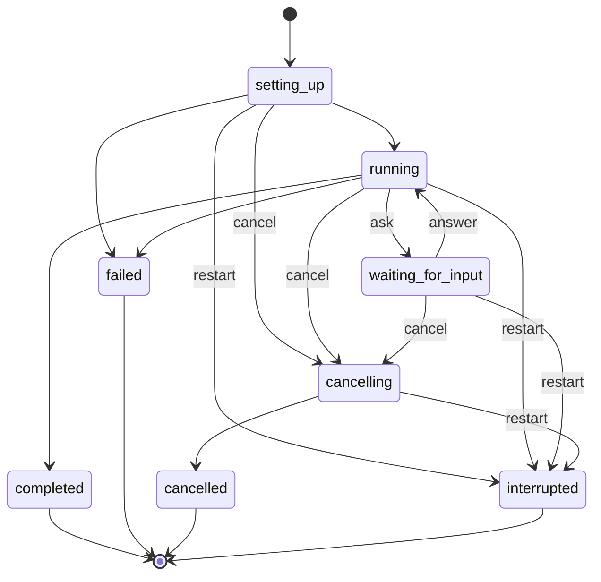

# Run lifecycle

How a run starts, where it executes, which states it goes through and what is left when it
ends. The maintainer decided this on 2026-11-14, in the system-design discussion of agenda
items 1 and 2 of [mvp.md](mvp.md). The terms are in the [glossary](glossary.md). None of it
is built yet.

## Where a run executes

The API starts one executor for each run, as a child process of its own. The executor runs
the harness for that run and nothing else.

- The executor talks only to the API, over a local channel. It does not connect to the
  database.
- The API is the only writer of the database, and so the only writer of a run's state. The
  executor reports what happens; the API stores it and decides the state.
- The API knows an executor died because its process exited. No heartbeat is needed.
- An executor does not outlive the API. When the API restarts, its executors end with it,
  and their runs become `interrupted`.

## States

| State               | Meaning                                                                 |
| ------------------- | ----------------------------------------------------------------------- |
| `setting_up`        | The prompt is accepted and stored, and the workspace is being prepared. |
| `running`           | The harness is working.                                                 |
| `waiting_for_input` | The run asked the user something and waits. Its last event is an ask.   |
| `cancelling`        | The user cancelled, and the executor is stopping what it started.       |
| `cancelled`         | The executor confirmed that everything stopped.                         |
| `completed`         | The run ended with its answer.                                          |
| `failed`            | The run ended with an error.                                            |
| `interrupted`       | The API restarted, or the executor died, while the run was not ended.   |

`cancelled`, `completed`, `failed` and `interrupted` are final: a run in one of them never
changes again.

## Rules

- **One active run per conversation.** A prompt sent while a run of the conversation is not
  ended is rejected as busy, as R05 requires. Nothing is queued.
- **One writing run per workspace.** Whether a run writes is known before it starts: its
  agent has tools that write, or it has none. Two runs that write in the same workspace
  would work against each other. Inside one run, several subagents may work in the
  workspace at once. On the server each session has worktrees of its own, so this follows
  from the rule above.
- **A new prompt waits for `cancelled`.** While a run is `cancelling`, what it started may
  still be writing, so the conversation stays busy until the executor confirms the stop.
- **No clear and no delete while a run is active.** The API rejects clearing or deleting a
  session whose conversation has a run that is not ended. The clients show a message or do
  not offer the action, and the API enforces it whatever the client does.
- **Cancelling rejects a pending ask.** A run cancelled while it is `waiting_for_input` has
  its ask rejected.
- **A late answer does not count.** An answer that arrives after the run was cancelled, or
  after the ask was answered, is not considered and does not resume anything.
- **A restart closes a pending ask.** The ask is a stored event, so a client that reconnects
  gets it again as the last event and can answer it. After a restart of the API the run that
  asked no longer exists: the run becomes `interrupted` and its ask is closed, so no client
  shows a question that leads nowhere.

## What is left after a run that does not complete

After `failed`, `cancelled` or `interrupted`, the user sees everything up to the last event,
and at most one more message that says what went wrong. Nothing is removed.

The next run can recover the conversation, and compacts it when it is very large.

## Alternatives considered

- **Running the harness inside the API's process.** The simplest: one process, and the
  harness's callbacks are plain calls. Rejected because a run that hangs or runs out of
  memory takes the API down with it, and because the commands a model starts would run as
  the user that holds the database credentials.
- **An executor as a service of its own.** It would also let the API restart without ending
  the runs. It needs a channel that survives either side going away, a heartbeat to tell a
  dead executor, and a way to reconcile both states when they meet again. Left for later:
  the states above do not change if the executor moves out.

## Open points

Not decided. Each is an input to the next design steps.

- **Who prepares the workspace.** Cloning the repository and adding the worktree need git
  credentials. Whether the API or the executor does it during `setting_up`, and with which
  credentials, is not decided.
- **The channel between the API and the executor.** What carries the events one way and the
  answers and the cancellation the other.
- **What the model is told.** Whether the next prompt tells the model that the earlier run
  did not complete.
- **Code a run changed before it stopped.** It might stay in the workspace until the user
  restores it (R09); this was assumed in the discussion, not confirmed.
- **Reasons within `failed`.** Whether a failed run names a kind of failure, such as the
  provider or the workspace, or only carries a message.

## Words used elsewhere

- **[#4](https://github.com/Mikode13/harness-api/issues/4)** names the same states for a
  task, with `queued` where this document says `setting_up`, and without `cancelling`.
- **[#6](https://github.com/Mikode13/harness-api/issues/6)** describes "a separately
  runnable backend executor" that claims queued tasks from PostgreSQL. Here the API starts
  an executor per run as its child, and the executor does not reach the database. The issue
  keeps its text until it is refined. Its other rules stand: a cancellation waits for the
  commands to end before it reports `cancelled`, a dead executor's work becomes
  `interrupted`, and a started prompt is never replayed by itself.
